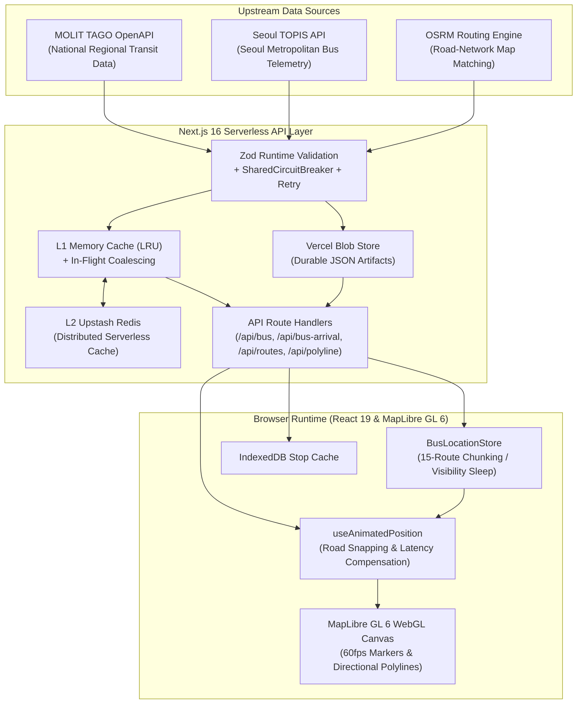

# wBus

[](./LICENSE)
[](https://nextjs.org/)
[](https://react.dev/)
[](https://www.typescriptlang.org/)
[](https://tailwindcss.com/)
[](https://maplibre.org/)
[-729B1B?logo=vitest)](https://vitest.dev/)

> *A high-performance, real-time public transit tracking platform supporting 140 municipalities across South Korea.*

---

## Table of Contents

- [Overview](#-overview)
- [Key Features](#-key-features)
    - [1. Real-Time Interactive Map & Telemetry](#1-real-time-interactive-map--telemetry)
    - [2. Nationwide Coverage (140 Cities & Counties)](#2-nationwide-coverage-140-cities--counties)
    - [3. Dynamic OSRM Road-Snapped Geometries](#3-dynamic-osrm-road-snapped-geometries)
    - [4. Multi-Tier Caching & Fault-Tolerant Pipeline](#4-multi-tier-caching--fault-tolerant-pipeline)
- [System Architecture](#-system-architecture)
- [Data Pipeline](#-data-pipeline)
- [Technology Stack](#-technology-stack)
- [API Reference](#-api-reference)
- [Getting Started](#-getting-started)
- [Available Scripts](#-available-scripts)
- [Automated Sync](#-automated-sync)
- [Testing & Quality](#-testing--quality)
- [License](#-license)

---

## 📋 Overview

`wBus` is a real-time public transit web platform built with **Next.js 16**, **React 19**, and **MapLibre GL 6** to
provide unified, low-latency bus tracking across South Korea.

By combining national public transit OpenAPIs with road-network geometry matching, multi-tier serverless caching, and
physics-based client interpolation, `wBus` delivers smooth 60fps vehicle motion across **140 supported cities and
counties** while minimizing upstream API load and mobile battery usage.

Core engineering pillars:

1. **Unified Nationwide Transit Data**: Integrates the Ministry of Land, Infrastructure and Transport (**MOLIT TAGO
   OpenAPI**) for regional municipalities alongside the **Seoul TOPIS (`ws.bus.go.kr`)** API behind consistent schemas
   and city-boundary guards.
2. **Smooth Physics-Based Telemetry**: Snaps 10-second telemetry updates onto road-matched OSRM polylines and
   interpolates vehicle motion using stop dwell-time modeling and server latency (`ageMs`) compensation.
3. **Serverless Multi-Tier Resiliency**: Combines L1 in-memory LRU caching, L2 **Upstash Redis** distributed caching,
   **Vercel Blob** durable artifact storage, in-flight request coalescing, and Zod runtime validation.
4. **Adaptive Client Efficiency**: Stores bulky stop metadata asynchronously in **IndexedDB**, chunks multi-route
   telemetry polling, and pauses background loops via the Page Visibility API.

---

## ✨ Key Features

### 1. Real-Time Interactive Map & Telemetry

- **Hardware-Accelerated Rendering (`MapLibre GL 6`)**:
    - WebGL vector map rendering with smooth 60fps pan, zoom, pitch, and bearing interactions.
    - Automatic synchronization between dark (`Darker`) and light (`Liberty`) map themes via `next-themes`.
- **Road-Snapped Dead Reckoning (`useAnimatedPosition`)**:
    - Projects live vehicle positions along road-snapped route polylines between 10-second polling intervals.
    - Accounts for upstream/cache response age (`serverAgeMs`) to compensate for telemetry delay, filters backward GPS
      jitter, and smoothly interpolates bearing angles.
- **Route Variations & Active Bus Drawer**:
    - Detects and groups sub-route variations under a shared route number with per-branch active vehicle counts.
    - Synchronizes the directional stop timeline with the active vehicle closest to the viewport center.
- **Stop Arrival Predictions & Spatial Search**:
    - Live stop arrival ETAs and remaining stop counts (`/api/bus-arrival/[busStopId]`).
    - Coordinate-based nearby stop discovery sorted by Haversine distance (`/api/stops/nearby`).

### 2. Nationwide Coverage (140 Cities & Counties)

- **Centralized City Directory (`/api/cities`)**:
    - Covers Special & Metropolitan Cities (Seoul, Sejong, Busan, Daegu, Incheon, Gwangju, Daejeon/Gyeryong, Ulsan,
      Jeju)
      and 131 provincial cities and counties nationwide.
- **City Switcher & GPS Auto-Detection (`CitySelectModal`)**:
    - Province-categorized browser with Korean initial-consonant (Choseong) search and one-click GPS city detection.
- **City Boundary Integrity**:
    - Enforces strict municipal boundary filters (`src/entities/city/routeBoundary.ts`) to keep cross-border route
      prefixes isolated cleanly per selected city.

### 3. Dynamic OSRM Road-Snapped Geometries

- **On-Demand Polyline Synthesis (`/api/polyline/[routeId]`)**:
    - Chunks ordered TAGO/TOPIS stop sequences through the OSRM routing engine to generate road-snapped vector
      geometries
      on demand.
    - Detects routing detours (`OSRM_DETOUR_TTL_MS = 15 min` temporary cache) and falls back gracefully to smooth spline
      geometry when needed.
    - Persists generated route geometries across serverless cold starts via **Vercel Blob** (with `/tmp` and `public/`
      filesystem fallbacks).

### 4. Multi-Tier Caching & Fault-Tolerant Pipeline

- **3-Tier Server Cache + Durable Artifact Store**:
    - **L1 Memory LRU (`CacheManager`)**: Sub-millisecond hits per warm serverless instance with bounded revalidation
      tracking (max 2,000 keys) and in-flight request deduplication.
    - **L2 Distributed Cache (`Upstash Redis`)**: Shared cache state across serverless instances (`KV_REST_API_*` /
      `UPSTASH_REDIS_REST_*`), including L2 `stale-if-error` fallback on cold starts.
    - **CDN Edge Micro-Caching & Poisoning Protection**: Prevents empty arrays (`[]`) or degraded fallback responses
      from
      entering shared caches (`Cache-Control: no-store` on degraded responses).
    - **Durable Artifact Store (`Vercel Blob`)**: Persists JSON route and dataset snapshots across deployments and cold
      starts.
- **Upstream Resiliency (`SharedCircuitBreaker` & `fetchWithRetry`)**:
    - 3-state circuit breakers (`CLOSED` ➔ `OPEN` ➔ `HALF_OPEN`), exponential backoff with jitter, bounded concurrency
      (`mapWithConcurrencyLimit`), and round-robin `DATA_GO_KR_SERVICE_KEYS` rotation with per-key rate-limit cooldowns.
- **Client Offline & Storage Optimization**:
    - IndexedDB storage (`src/shared/cache/idbStorage.ts`) for large stop datasets instead of synchronous
      `localStorage`.
    - Service Worker (`public/sw.js`) static asset pre-caching and PWA Add-to-Home-Screen support.

---

## 🏗️ System Architecture

`wBus` follows **Feature-Sliced Design (FSD)** principles to maintain strict, unidirectional module dependencies: `app`
➔ `widgets` ➔ `features` ➔ `entities` ➔ `shared`.

```text
src/
├── app/                          # Next.js App Router (Pages & Serverless API Routes)
│   ├── api/
│   │   ├── bus/                  # Batched & single-route live bus telemetry + health check
│   │   ├── bus-arrival/          # Real-time stop arrival predictions
│   │   ├── bus-stops/            # Ordered stop sequences by route ID
│   │   ├── cities/               # Directory of 140 supported cities and city codes
│   │   ├── cron/refresh/         # Scheduled dataset & route catalog synchronization
│   │   ├── polyline/             # On-demand OSRM road-snapped route polyline generator
│   │   ├── route-stops/          # Directional (UP/DOWN) stop lists by route number
│   │   ├── routes/               # Per-city route catalog & manual synchronization
│   │   ├── schedule/             # Route schedule metadata & refresh endpoint
│   │   └── stops/nearby/         # Coordinate-based spatial search for nearby bus stops
│   ├── schedule/                 # Dedicated timetable explorer route
│   ├── privacy/ & terms/         # Legal & privacy policy pages
│   ├── globals.css               # Tailwind CSS 4 theme tokens & global styles
│   ├── layout.tsx                # Root layout (metadata, theme & global providers)
│   └── page.tsx                  # Primary interactive map application entry
├── entities/                     # Core domain models, API adapters & business services
│   ├── bus/                      # TAGO/TOPIS clients, operating window helpers, circuit breakers
│   ├── city/                     # 140 city codes, municipal bounds, boundary filters, CityContext
│   ├── notice/                   # Transit notice DOM scraper & domain model
│   ├── route/                    # Route synchronization service, OSRM client, polyline chunker
│   ├── schedule/                 # Timetable dataset loader, variant resolver, DOM scraper
│   └── station/                  # Stop filtering, IndexedDB stop cache, turnaround detection
├── features/                     # User-facing interactive workflows
│   ├── city-select/              # Nationwide city selector modal & GPS auto-detection
│   ├── live-tracking/            # BusLocationStore (15-route chunking, latency tracking), snapService
│   └── map-view/                 # Map viewport orchestration, schedule modal, header controls
├── shared/                       # Shared infrastructure, validation, caching & UI primitives
│   ├── animation/                # useAnimatedPosition (dead reckoning & bearing interpolation)
│   ├── api/                      # createApiHandler, upstreamClient, Zod schemas, validators
│   ├── cache/                    # CacheManager, L2 Redis adapter, Blob artifactStore, idbStorage
│   ├── config/                   # Storage keys, page routes, cookie & locale config
│   ├── context/                  # Global MapLibre context
│   ├── lib/                      # Time & countdown utilities
│   ├── types/                    # Shared TypeScript definitions
│   ├── ui/                       # Reusable UI primitives (Modal, Pill, MarqueeText, ThemeToggle)
│   └── utils/                    # Haversine/geo math, Hangul search, XSS sanitizer, concurrency
└── widgets/                      # Self-contained composite UI blocks
    ├── AppShell/                 # Application shell & navigation orchestrator
    ├── BottomNav/                # Floating navigation bar, stop search & active bus drawer
    └── MapContainer/             # MapLibre GL canvas, bus markers, stop pins, route polylines
```

---

## 🔄 Data Pipeline



---

## 🛠️ Technology Stack

| Layer | Technology | Version | Role & Highlights |
| :--- | :--- | :--- | :--- |
| **Framework** | Next.js (App Router) | `16.4.1` | Turbopack dev server, Serverless Route Handlers, RSC |
| **UI Library** | React | `19.3.1` | Concurrent rendering, external telemetry stores & animation hooks |
| **Language** | TypeScript | `6.0.3` | Strict type checking across geospatial, API, and UI layers |
| **Validation** | Zod | `4.6.7` | Runtime validation for upstream TAGO/OSRM payloads & JSON artifacts |
| **Styling** | Tailwind CSS | `4.3.3` | Zero-runtime CSS-first styling with adaptive light/dark themes |
| **Map Engine** | MapLibre GL / react-map-gl | `6.14.0` / `8.1.3` | WebGL vector tile rendering, pitch/bearing controls |
| **Server Storage** | `@upstash/redis` / `@vercel/blob` | `1.41.0` / `2.9.0` | L2 distributed serverless cache & durable artifact persistence |
| **Parsing** | `node-html-parser` | `9.0.7` | Resilient DOM parsing for transit timetable and advisory feeds |
| **Client Fetching** | SWR | `2.5.1` | Client revalidation paired with IndexedDB & external stores |
| **Routing Engine** | OSRM (Driving Profile) | — | Stop-sequence road matching and fallback spline synthesis |
| **Testing** | Vitest | `5.0.5` (`5.1.0`) | 53 test suites / 406 unit & integration tests |
| **Observability** | Vercel Analytics / Speed Insights | `2.0.1` / `2.0.0` | Real-user Core Web Vitals & telemetry |

---

## 📡 API Reference

All API handlers apply standardized error handling, Zod/parameter validation, and anti-poisoning `Cache-Control` rules
(`no-store` automatically on degraded upstream responses).

| Method | Endpoint | Description | Cache Policy (`Cache-Control`) |
| :--- | :--- | :--- | :--- |
| `GET` | `/api/bus?routeIds=...&cityCode=...` | Batched live bus telemetry across multiple route IDs | `max-age=2, s-maxage=10`, SWR `5s`, `stale-if-error=60` |
| `GET` | `/api/bus/[routeId]?cityCode=...` | Live bus telemetry and direction for a single route | `max-age=2, s-maxage=10`, SWR `5s`, `stale-if-error=60` |
| `GET` | `/api/bus/health` | Circuit breakers, key pool, L1 cache, and Redis/Blob backend health | `no-store` |
| `GET` | `/api/bus-arrival/[busStopId]?cityCode=...` | Live approaching bus ETAs for a specific stop | `max-age=1, s-maxage=3`, SWR `5s`, `stale-if-error=60` |
| `GET` | `/api/bus-stops/[routeId]?cityCode=...` | Ordered stop sequence for a specific route | `s-maxage=86400`, SWR `86400s` (+ L2 Redis) |
| `GET` | `/api/route-stops/[routeName]?cityCode=...` | Directional (`UP`/`DOWN`) stop lists grouped by route number | `s-maxage=86400`, SWR `86400s` (+ L2 Redis) |
| `GET` | `/api/routes?cityCode=...` | Route catalog for a given municipality | `max-age=3600, s-maxage=86400`, SWR `7d` (+ L2 Redis) |
| `GET` | `/api/polyline/[routeId]?cityCode=...` | Road-snapped OSRM vector polyline for a route | `max-age=86400, s-maxage=604800`, SWR `30d` (+ Blob) |
| `GET` | `/api/stops/nearby?lat=...&lng=...&limit=...` | Nearby bus stops sorted by Haversine distance | `max-age=30, s-maxage=60`, SWR `120s` |
| `GET` | `/api/cities` | Nationwide directory of all 140 supported cities and city codes | `s-maxage=86400`, SWR `86400s` |
| `GET` | `/api/schedule` | Route timetable snapshot & refresh metadata | `max-age=60`, SWR `300s` |
| `GET/POST` | `/api/routes/refresh` | Manual route catalog & geometry resynchronization | `no-store` (Bearer Auth) |
| `GET/POST` | `/api/schedule/refresh` | On-demand schedule snapshot refresh & tag invalidation | `no-store` (Bearer Auth) |
| `GET/POST` | `/api/cron/refresh?target=...` | Scheduled Vercel refresh endpoint (`auto`, `routes`, `all`) | `no-store` (Bearer Auth) |

---

## ⚡️ Getting Started

### Prerequisites

- **Node.js**: `20.18.0` or higher (LTS recommended)
- **npm**: `10.x` or higher

### 1. Clone & Install Dependencies

```bash
git clone https://github.com/kernelily/wBus.git && cd wBus
npm install
```

### 2. Configure Environment Variables

Copy `.env.example` to `.env.local` (or pull linked environment variables via `vercel env pull`):

```bash
cp .env.example .env.local
```

Configure the keys in `.env.local`:

```dotenv
# Required: Korea Public Data Portal (TAGO OpenAPI & Seoul TOPIS) Service Key
# Comma-separated keys are supported for automatic rotation.
DATA_GO_KR_SERVICE_KEY="YOUR_PUBLIC_DATA_PORTAL_KEY"
# DATA_GO_KR_SERVICE_KEYS="KEY_1,KEY_2,KEY_3"

# Optional: OSRM Routing Engine endpoint (defaults to public OSRM server)
# OSRM_API_URL="https://router.project-osrm.org/route/v1/driving"

# Optional: Secret token for Vercel Schedules / Cron & refresh endpoints (>= 16 chars)
# CRON_SECRET=""

# Optional: L2 Distributed Cache (Upstash Redis or Vercel KV; falls back to L1 memory)
# UPSTASH_REDIS_REST_URL=""
# UPSTASH_REDIS_REST_TOKEN=""

# Optional: Durable Artifact Store (Vercel Blob; falls back to /tmp & public/)
# BLOB_READ_WRITE_TOKEN=""
# BLOB_ACCESS="private"
```

> [!NOTE]
> `DATA_GO_KR_SERVICE_KEY` can be issued from the [Korea Public Data Portal (data.go.kr)](https://www.data.go.kr/) for
the MOLIT Bus Location & Bus Route OpenAPIs and Seoul TOPIS endpoints. Without Redis or Blob credentials configured,
`wBus` automatically falls back to L1 in-memory caching and local filesystem storage.

### 3. Start the Development Server

```bash
npm run dev
```

Open [http://localhost:3000](http://localhost:3000) in your browser.

---

## 📜 Available Scripts

```bash
# Start local development server with Turbopack
npm run dev

# Build production bundle (webpack)
npm run build

# Start production server
npm run start

# Run ESLint static analysis
npm run lint

# Run ESLint with auto-fixes
npm run lint:fix

# Run TypeScript type checking
npm run typecheck

# Run full Vitest test suite
npm run test
```

---

## ⏱️ Automated Sync

`wBus` uses **Vercel Schedules** configured in [`vercel.json`](./vercel.json) to synchronize datasets automatically:

- **`daily-refresh` (`0 19 * * *` UTC / `04:00 KST`)**:
    - Triggers `GET /api/cron/refresh`, updates timetable snapshots, invalidates Next.js cache tags (`revalidatePath`),
      and runs weekly route catalog synchronization (`?target=auto` on Sundays UTC, or on demand via `?target=all` /
      `?target=routes`).
- **Authentication**:
    - Protected in production via `Authorization: Bearer <CRON_SECRET>` (or `ADMIN_KEY`).

```bash
# Example: Manually trigger a full refresh against a deployed instance
curl -X GET "https://your-domain.vercel.app/api/cron/refresh?target=all" \
  -H "Authorization: Bearer YOUR_CRON_SECRET"
```

---

## 🧪 Testing & Quality

`wBus` passes **53 test files (406 tests)** under Vitest covering:

- **Geospatial & Dead Reckoning**: Road-network snapping, dwell-time modulation, latency compensation, and city boundary
  filtering (`routeBoundary`, `geo`, `polylineChunker`, `snapService`).
- **Resilience & Caching**: `CacheManager` LRU/TTL bounds, `createApiHandler` anti-poisoning headers, `distributedCache`
  L2 fallback behavior, multi-key cooldown rotation (`seoulApi`), and `BusLocationStore` batching/cleanup.
- **Validation & Parsing**: Zod upstream schemas (`schemas.test.ts`), HTML DOM scrapers (`itsScraper.test.ts`,
  `noticeScraper.test.ts`), schedule variant logic, and polyline generation.

```bash
npm run test && npm run typecheck && npm run lint
```

---

## 📄 License

Distributed under the [MIT License](./LICENSE).
