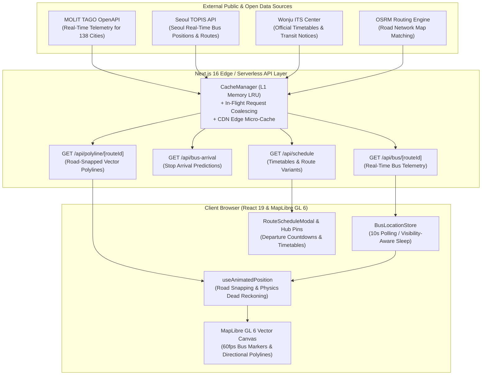

# wBus

[](./LICENSE)
[](https://nextjs.org/)
[](https://react.dev/)
[](https://www.typescriptlang.org/)
[](https://tailwindcss.com/)
[](https://maplibre.org/)
[-729B1B?logo=vitest)](https://vitest.dev/)

> *A high-performance, real-time transit tracking and timetable platform supporting Wonju City and 139 municipalities
> across South Korea.*

---

## Table of Contents

- [Overview](#-overview)
- [Key Features](#-key-features)
  - [1. Real-Time Interactive Map & Telemetry](#1-real-time-interactive-map--telemetry)
  - [2. Hub Timetable Pins & Schedule Explorer](#2-hub-timetable-pins--schedule-explorer)
  - [3. Nationwide Transit Support (139 Cities)](#3-nationwide-transit-support-139-cities)
  - [4. Wonju ITS Transit Notice Center](#4-wonju-its-transit-notice-center)
  - [5. Multi-Tier Caching & High-Resiliency Architecture](#5-multi-tier-caching--high-resiliency-architecture)
- [System Architecture](#-system-architecture)
- [Data Pipeline](#-data-pipeline)
- [Technology Stack](#-technology-stack)
- [API Reference](#-api-reference)
- [Getting Started](#-getting-started)
- [Available Scripts](#-available-scripts)
- [Automated Updates](#-automated-updates)
- [Testing & Quality](#-testing--quality)
- [License](#-license)

---

## 📋 Overview

`wBus` is a next-generation real-time public transit web platform engineered to eliminate information asymmetry and
sluggish user experiences for daily commuters.

Traditional transit portals and municipal bus apps often report only garage origin departure times—making it difficult
to determine actual departures at major hubs and turnaround points—while suffering from choppy telemetry updates and
excessive background network polling.

`wBus` is built around four core engineering pillars:

1. **Accurate Hub & Turnaround Schedules**: Provides clear, structured departure schedules and variant detection
   (Weekday, Saturday, Holiday) across major transit terminals and turnaround hubs, complete with real-time countdowns
   to the next departure.
2. **Smooth Physics-Based Telemetry**: Combines OSRM road-network vector map matching with physics-based dead reckoning
   to smoothly interpolate vehicle motion along actual road geometries between 10-second public API polling intervals.
3. **Nationwide Coverage Across 139 Cities**: Integrates the Ministry of Land, Infrastructure and Transport (MOLIT) TAGO
   OpenAPI (138 cities/counties) alongside the Seoul Metropolitan Government Bus Information System (TOPIS) for seamless
   nationwide tracking.
4. **Resource Efficiency & Resiliency**: Employs an L1 in-memory LRU cache, in-flight request coalescing, CDN edge
   micro-caching, and Page Visibility sleep/wake cycles to minimize mobile battery drain and cellular data usage.

---

## ✨ Key Features

### 1. Real-Time Interactive Map & Telemetry

- **Hardware-Accelerated Rendering (`MapLibre GL 6`)**:
  - WebGL-powered vector tile rendering delivering smooth 60fps pan, zoom, pitch, and bearing interactions.
  - Automatic synchronization between dark (`Darker`) and light (`Liberty`) map styles via `next-themes`.
- **Road-Snapped Dead Reckoning Interpolation (`useAnimatedPosition`)**:
  - Matches 10-second TAGO/TOPIS telemetry updates against high-precision OSRM road polylines.
  - Projects continuous forward motion factoring in stop dwell-time weighting and network latency compensation.
  - Prevents coordinate teleportation, filters backward GPS jitter, and smoothly interpolates vehicle heading angles.
- **Directional Filtering & Route Trajectories**:
  - Automatically classifies vehicles and stops into Inbound/Up (`UP`, Origin ➔ Terminal) and Outbound/Down (`DOWN`,
    Terminal ➔ Origin) directions.
  - Interactive header controls for filtering route polylines and live bus markers by direction (`ALL`, `UP`, `DOWN`).
  - Active bus list drawer that automatically synchronizes the route timeline with the vehicle nearest to the map
    center.
- **High-Precision GPS Tracking**:
  - Real-time user location indicator with accuracy radius visualization.
  - Automatic out-of-bounds detection modal when navigating outside the active city's service area.
  - One-click compass reset and viewport zoom controls.
- **Live Stop Arrival Predictions (`/api/bus-arrival`)**:
  - Clicking any bus stop marker reveals approaching routes, remaining stop counts, and estimated arrival times (ETA in
    seconds).
  - Radius-based spatial discovery of nearby stops (`/api/stops/nearby`).

### 2. Hub Timetable Pins & Schedule Explorer

- **Origin & Turnaround Map Pins (`TimetablePinMarker`)**:
  - Displays interactive timetable pins at key origins, terminals, and turnaround hubs directly on the map canvas.
  - Dynamically scales pin visibility by zoom level to prevent map clutter.
  - Clicking a pin opens the full route schedule modal with real-time countdown badges for upcoming departures.
- **Integrated Route Schedule Modal (`RouteScheduleModal`)**:
  - Automatic schedule variant resolution (`AUTO`, Weekday, Saturday, Sunday/Holiday) via
    `resolveActiveScheduleVariant`.
  - Detailed route notes (via-point variations, early departures, terminal loops) and one-click CSV timetable export.

### 3. Nationwide Transit Support (139 Cities)

- **Comprehensive National Coverage**:
  - Unified integration with MOLIT TAGO Bus Location & Route OpenAPIs (138 municipalities) and Seoul TOPIS
    (`ws.bus.go.kr`).
- **City Switcher Modal (`CitySelectModal`)**:
  - Categorized regional tabs covering Special/Metropolitan Cities, Gyeonggi (31), Gangwon (7), Chungcheong, Jeolla,
    Gyeongsang, and Jeju.
  - Instant search with Korean initial-consonant (Choseong) matching.
  - One-click GPS city auto-detection to immediately switch to the user's current municipality.
- **On-Demand Dynamic Polyline Generation**:
  - For regional routes without pre-built static geometries, `wBus` dynamically chunks stop sequences and synthesizes
    road-snapped OSRM vector polylines on the fly, caching the results at the edge.

### 4. Wonju ITS Transit Notice Center

- Scrapes and caches official transit advisories from the Wonju Intelligent Transport Systems (`its.wonju.go.kr`)
  portal.
- Surfaces urgent announcements—such as road construction detours, route revisions, and timetable updates—via a header
  marquee banner and an interactive detail modal.

### 5. Multi-Tier Caching & High-Resiliency Architecture

- **3-Tier Caching Pipeline**:
  - **L1 In-Memory LRU Cache**: Delivers sub-millisecond responses within warm serverless instances.
  - **In-Flight Request Coalescing**: Deduplicates concurrent requests for the same route so only a single upstream
    public API call is dispatched.
  - **CDN Edge Micro-Caching**: Configured with `s-maxage=10, stale-while-revalidate=5` to absorb traffic spikes
    effortlessly.
- **Multi-Key Rotation & Circuit Breaker (`DATA_GO_KR_SERVICE_KEYS`)**:
  - Supports comma-separated public data API keys with round-robin load balancing, quota exhaustion detection, and
    automatic per-key cooldown recovery.
  - Built-in 3-state Circuit Breaker (`CLOSED` ➔ `OPEN` ➔ `HALF_OPEN`) to protect against upstream government API
    outages.
- **Battery & Data Saver**:
  - Listens to the browser Page Visibility API to pause telemetry polling and `requestAnimationFrame` loops immediately
    when the tab is backgrounded, resuming seamlessly on focus.
- **Progressive Web App (PWA) & Offline Support**:
  - Service Worker (`sw.js`) pre-caching for static assets and map resources.
  - Full Add-to-Home-Screen (A2HS) support with iOS Dynamic Island and Safe Area full-bleed viewport adaptation.

---

## 🏗️ System Architecture

`wBus` follows **Feature-Sliced Design (FSD)** principles to enforce clear module boundaries and unidirectional
dependencies.

```text
src/
├── app/                          # Next.js App Router (Pages & Serverless API Routes)
│   ├── api/                      # REST API endpoints
│   │   ├── bus/                  # Real-time bus telemetry, batch queries, health check
│   │   ├── bus-arrival/          # Real-time stop arrival predictions
│   │   ├── bus-stops/            # Ordered stop sequences per route
│   │   ├── cities/               # Nationwide directory of 139 supported municipalities
│   │   ├── cron/refresh/         # Vercel Cron endpoint for automated dataset synchronization
│   │   ├── notice/               # Wonju ITS transit notice scraper & detail API
│   │   ├── polyline/             # On-demand OSRM road-snapped polyline generator
│   │   ├── route-stops/          # Directional (UP/DOWN) stop mapping by route name
│   │   ├── routes/               # Per-city route catalog & synchronization
│   │   ├── schedule/             # Wonju bus timetables & cache invalidation
│   │   └── stops/nearby/         # Coordinate-based spatial search for nearby stops
│   ├── data/[...path]/           # Static geometry asset & on-demand vector proxy
│   ├── privacy/ & terms/         # Legal & privacy policy pages
│   ├── schedule/                 # Dedicated schedule exploration route
│   ├── globals.css               # Tailwind CSS 4 theme & global stylesheet
│   ├── layout.tsx                # Root layout (SEO metadata, theme & global providers)
│   └── page.tsx                  # Primary application entry point
├── entities/                     # Core domain models & data services
│   ├── bus/                      # Bus telemetry models, TAGO/TOPIS clients, circuit breaker
│   ├── city/                     # 139 city codes, coordinate bounds, CityContext
│   ├── notice/                   # Wonju ITS notice parser & domain schema
│   ├── route/                    # Route definitions, OSRM routing engine, polyline chunker
│   ├── schedule/                 # Timetable schemas, variant resolver, schedule utilities
│   └── station/                  # Stop coordinates, turnaround detector, Kakao Roadview link
├── features/                     # User-facing interactive features & business logic
│   ├── city-select/              # City selection modal & GPS-based city auto-detection
│   ├── live-tracking/            # BusLocationStore, interpolation store, heading calculator
│   └── map-view/                 # Map viewport orchestration, RouteScheduleModal, MapRouteHeader
├── shared/                       # Reusable infrastructure, hooks, and UI primitives
│   ├── animation/                # useAnimatedPosition (physics-based dead reckoning)
│   ├── api/                      # Shared fetchers, error handlers, request validators
│   ├── cache/                    # CacheManager (L1 In-Memory LRU + request coalescing)
│   ├── config/                   # Environment schema, localization dictionary, storage keys
│   ├── context/                  # AppMapContext (global MapLibre instance management)
│   ├── lib/                      # Time formatting & countdown utilities (timeUtils)
│   ├── types/                    # Global TypeScript type definitions
│   ├── ui/                       # Design system primitives (Pill, ThemeToggle, Marquee, etc.)
│   └── utils/                    # Geospatial math (geo), XSS sanitizer, concurrency limiter
└── widgets/                      # Self-contained composite UI blocks
    ├── AppShell/                 # Primary application shell & route/tab orchestrator
    ├── BottomNav/                # Floating bottom navigation bar & active bus list drawer
    ├── MapContainer/             # MapLibre GL canvas wrapper, bus/stop/timetable pin layers
    ├── NoticeWidget/             # Wonju ITS transit notice banner & modal
    └── TimetableWidget/          # Standalone timetable exploration widget
```

> **FSD Dependency Rule**: `app` ➔ `widgets` ➔ `features` ➔ `entities` ➔ `shared` (strictly unidirectional imports)

---

## 🔄 Data Pipeline



---

## 🛠️ Technology Stack

| Layer                | Technology                        | Version            | Key Role & Highlights                                              |
|:---------------------|:----------------------------------|:-------------------|:-------------------------------------------------------------------|
| **Framework**        | Next.js (App Router)              | `16.4.1`           | Turbopack dev server, React Server Components, Serverless Routes   |
| **UI Library**       | React                             | `19.3.1`           | Concurrent rendering, strict mode, high-frequency animation hooks  |
| **Language**         | TypeScript                        | `6.0.3`            | End-to-end strict type safety across geospatial & domain schemas   |
| **Styling**          | Tailwind CSS                      | `4.3.3`            | CSS-first engine, zero runtime overhead, adaptive dark/light theme |
| **Map Rendering**    | MapLibre GL / react-map-gl        | `6.14.0` / `8.1.3` | WebGL vector map rendering, 3D pitch/bearing, dynamic style switch |
| **State & Fetching** | SWR / Custom External Stores      | `2.5.1`            | In-memory reactive stores, background revalidation, visibility API |
| **Icons**            | Lucide React                      | `1.57.0`           | Crisp, customizable vector iconography                             |
| **Theme System**     | next-themes                       | `0.4.6`            | SSR-safe system/dark/light theme synchronization without flash     |
| **Routing Engine**   | OSRM (MLD Algorithm)              | -                  | Stop-sequence road network map matching and spline synthesis       |
| **Testing**          | Vitest                            | `5.1.0`            | 253 unit tests covering geospatial math, physics, and caching      |
| **Analytics**        | Vercel Analytics / Speed Insights | `2.0.1` / `2.0.0`  | Real-user Core Web Vitals and interaction performance telemetry    |

---

## 📡 API Reference

All API endpoints feature low-latency serialization, CDN edge micro-caching headers, and upstream circuit-breaker
protection.

| Method     | Endpoint                                       | Description                                                    | Cache Policy (`Cache-Control`) |
|:-----------|:-----------------------------------------------|:---------------------------------------------------------------|:-------------------------------|
| `GET`      | `/api/bus?routeIds=...&cityCode=...`           | Batch query real-time bus locations across multiple routes     | `s-maxage=10`, SWR: `5s`       |
| `GET`      | `/api/bus/[routeId]?cityCode=...`              | Real-time GPS telemetry and direction for a specific route     | `s-maxage=10`, SWR: `5s`       |
| `GET`      | `/api/bus/health`                              | Upstream public API connectivity and circuit-breaker status    | `no-store`                     |
| `GET`      | `/api/bus-arrival/[busStopId]?cityCode=...`    | Real-time approaching bus ETAs for a specific stop             | `s-maxage=5`, SWR: `5s`        |
| `GET`      | `/api/bus-stops/[routeId]?cityCode=...`        | Ordered sequence of stops belonging to a specific route        | `s-maxage=86400` (1 day)       |
| `GET`      | `/api/route-stops/[routeName]?cityCode=...`    | Directional (`UP`/`DOWN`) stop lists grouped by route number   | `s-maxage=86400` (1 day)       |
| `GET`      | `/api/routes?cityCode=...`                     | Complete catalog of operating bus routes for a given city      | `s-maxage=86400` (1 day)       |
| `GET`      | `/api/polyline/[routeId]?cityCode=...`         | High-precision road-snapped OSRM vector polyline for a route   | `s-maxage=604800` (7 days)     |
| `GET`      | `/api/stops/nearby?lat=...&lng=...&radius=...` | Spatial search for bus stops within a radius (default: `500m`) | `s-maxage=3600` (1 hour)       |
| `GET`      | `/api/cities`                                  | Directory of all 139 supported cities and TAGO city codes      | `s-maxage=86400` (1 day)       |
| `GET`      | `/api/schedule`                                | Wonju route timetables, hub departures, and schedule metadata  | `s-maxage=60`, SWR: `300s`     |
| `GET/POST` | `/api/schedule/refresh`                        | On-demand Wonju ITS timetable scrape and cache invalidation    | `no-store`                     |
| `GET/POST` | `/api/routes/refresh`                          | Manual resynchronization of route catalogs and stop mappings   | `no-store`                     |
| `GET`      | `/api/notice`                                  | Official Wonju ITS transit notices and advisories list         | `s-maxage=900` (15 min)        |
| `GET`      | `/api/notice/[id]`                             | Detailed body content for a specific Wonju ITS transit notice  | `s-maxage=600` (10 min)        |
| `GET/POST` | `/api/cron/refresh?target=...`                 | Unified Vercel Cron trigger (daily schedules + weekly routes)  | `no-store` (Bearer Auth)       |
| `GET`      | `/data/[...path]`                              | Static geometry asset and on-demand vector file proxy          | `s-maxage=604800` (7 days)     |

---

## ⚡️ Getting Started

### Prerequisites

- **Node.js**: `20.18.0` or higher (LTS recommended)
- **Package Manager**: `npm 10.x` or higher

### 1. Clone the Repository & Install Dependencies

```bash
git clone https://github.com/kernelily/wBus.git && cd wBus
npm install
```

### 2. Configure Environment Variables

Copy `.env.example` to `.env.local`:

```bash
cp .env.example .env.local
```

Populate `.env.local` with your credentials:

```dotenv
# Korea Public Data Portal (TAGO OpenAPI & Seoul TOPIS) Service Key
# Supports either a single key or comma-separated keys for automatic rotation.
DATA_GO_KR_SERVICE_KEY="YOUR_PUBLIC_DATA_PORTAL_KEY"
# DATA_GO_KR_SERVICE_KEYS="KEY_1,KEY_2,KEY_3"

# OSRM Routing Engine Endpoint (Default: public OSRM demo server)
# OSRM_API_URL="https://router.project-osrm.org/route/v1/driving"

# Secret token for authenticating Vercel Cron / dataset refresh requests (Optional)
# CRON_SECRET=""
```

> [!NOTE]
> You can obtain a `DATA_GO_KR_SERVICE_KEY` from the [Korea Public Data Portal (data.go.kr)](https://www.data.go.kr/) by
subscribing to the **MOLIT Bus Location Information** and **MOLIT Bus Route Information** OpenAPIs. Seoul TOPIS
endpoints share the same key infrastructure.

### 3. Run the Development Server

Start the local Next.js development server powered by `Turbopack`:

```bash
npm run dev
```

Open [http://localhost:3000](http://localhost:3000) in your browser to inspect the application.

---

## 📜 Available Scripts

Key scripts defined in `package.json`:

```bash
# Start local development server with Next.js Turbopack
npm run dev

# Build optimized production bundle
npm run build

# Start production server
npm run start

# Run ESLint static analysis
npm run lint

# Run ESLint with automatic fixes
npm run lint:fix

# Run strict TypeScript type checking
npm run typecheck

# Execute the full Vitest unit test suite
npm run test
```

---

## ⏱️ Automated Updates

`wBus` includes an automated serverless synchronization pipeline to keep transit datasets aligned with upstream
municipal changes (route reorganizations, stop updates, and timetable revisions).

### Vercel Cron (`/api/cron/refresh`)

- **Daily Timetable Sync (04:00 KST / 19:00 UTC)**:
  - Scrapes the latest official timetables from Wonju ITS, updates runtime data, and invalidates cached responses
    (`revalidatePath("/api/schedule")`).
- **Weekly Route & Geometry Sync (Sundays)**:
  - Audits nationwide route catalogs, stop sequences, and polyline geometries against the TAGO OpenAPI.
- **Security**:
  - Protected via `Authorization: Bearer <CRON_SECRET>` header verification.

```bash
# Example: Manually trigger a full dataset refresh via cURL
curl -X POST "https://your-domain.vercel.app/api/cron/refresh?target=all" \
  -H "Authorization: Bearer YOUR_CRON_SECRET"
```

---

## 🧪 Testing & Quality

`wBus` maintains a comprehensive Vitest unit test suite across 32 test files (253 passing assertions) to guarantee
accuracy in high-frequency telemetry and geospatial operations:

- **Geospatial & Physics Interpolation**: Road-network snapping, dwell-time deceleration curves, latency compensation,
  and shortest-arc bearing interpolation.
- **Caching & Concurrency Control**: LRU eviction policies, in-flight request coalescing, bounded concurrency
  (`mapWithConcurrencyLimit`), and multi-key circuit breaker state transitions.
- **Domain Business Logic**: Schedule variant resolution, holiday/weekend detection, and directional (`UP`/`DOWN`) stop
  sequence splitting.

```bash
# Run all unit tests
npm run test

# Verify TypeScript compilation
npm run typecheck
```

---

## 📄 License

This project is open-source software distributed under the [MIT License](./LICENSE). Contributions, issues, and forks
are welcome.
