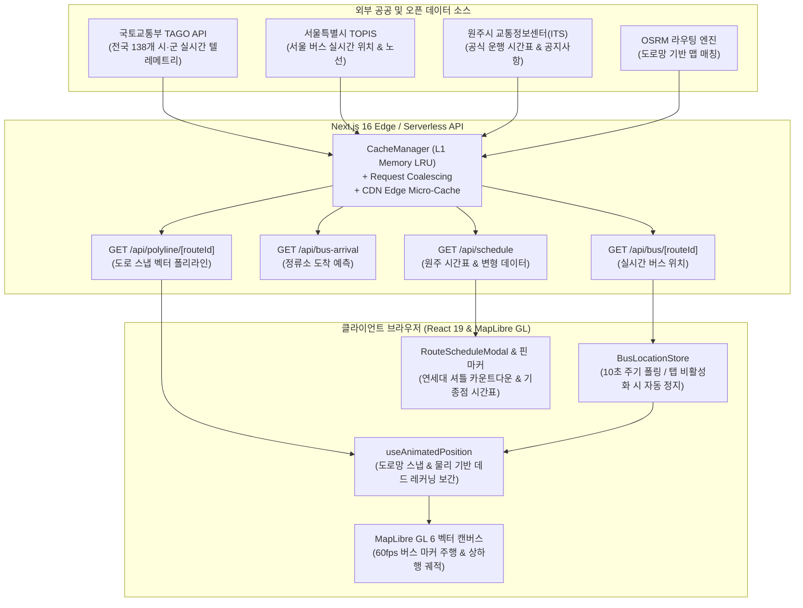

# wBus

[](./LICENSE)
[](https://nextjs.org/)
[](https://react.dev/)
[](https://www.typescriptlang.org/)
[](https://tailwindcss.com/)
[](https://maplibre.org/)
[-729B1B?logo=vitest)](https://vitest.dev/)

> *A high-performance real-time transit tracking & timetable exploration platform for Wonju City, Yonsei University
Mirae Campus, and 139 cities across South Korea.*

---

## Table of Contents

- [개요 (Overview)](#-overview)
- [핵심 기능 (Key Features)](#-key-features)
  - [1. 연세대학교 미래캠퍼스 특화 모드](#1-연세대학교-미래캠퍼스-특화-모드-yonsei-university-mode)
  - [2. 인터랙티브 실시간 지도 및 텔레메트리](#2-인터랙티브-실시간-지도-및-텔레메트리-real-time-map--telemetry)
  - [3. 지도 거점 시간표 핀](#3-지도-거점-시간표-핀-hub-timetable-pins)
  - [4. 전국 139개 시·군 광역 확장](#4-전국-139개-시군-광역-확장-nationwide-transit-support)
  - [5. 원주시 ITS 교통 공지사항 센터](#5-원주시-its-교통-공지사항-센터-wonju-its-notice-center)
  - [6. 회복탄력적 멀티티어 캐싱 & 고성능 설계](#6-회복탄력적-멀티티어-캐싱--고성능-설계-performance--resiliency)
- [시스템 아키텍처 (System Architecture)](#-system-architecture)
- [데이터 파이프라인 & 텔레메트리 흐름 (Data Pipeline)](#-data-pipeline)
- [기술 스택 (Technology Stack)](#-technology-stack)
- [API 레퍼런스 (API Reference)](#-api-reference)
- [시작하기 & 로컬 개발 환경 (Getting Started)](#-getting-started)
- [사용 가능한 스크립트 (Available Scripts)](#-available-scripts)
- [자동 데이터 동기화 (Automated Updates)](#-automated-updates)
- [테스트 및 코드 품질 (Testing & Quality)](#-testing--quality)
- [라이선스 (License)](#-license)

---

## 📋 Overview

`wBus`는 대중교통 이용객 및 통학·통근자의 고질적인 정보 비대칭과 불편을 해소하기 위해 엔지니어링된 차세대 실시간 대중교통 웹 플랫폼입니다.

기존 포털 지도나 공공 버스 앱은 기점 (차고지) 출발 시간만 안내하여 정작 캠퍼스나 주요 경유지에서의 실제 출발 시간을 알기 어렵거나, 과도한 백그라운드 네트워크 통신과 뚝뚝 끊기는 위치 갱신으로 사용자 경험을
저해해 왔습니다.

`wBus`는 다음의 핵심 원칙을 기반으로 제작되었습니다:

1. **정확한 출발 정보**: 원주시 30번, 34번, 34-1번 노선의 장양리 차고지 기준 왜곡을 걷어내고, 실제 **연세대학교 미래캠퍼스 정문/회촌 순수 출발 시각**과 **교내 셔틀버스 실시간 카운트다운**을
   제공합니다.
2. **부드러운 실시간 관제**: OSRM 도로망 벡터 맵 매칭과 물리 기반 추측 항법 (Dead Reckoning)을 접목하여, 10초 주기 공공데이터 갱신 주기 사이에서도 버스가 도로를 따라 부드럽게 주행하도록
   실시간 보간합니다.
3. **전국 139개 시·군 확장**: 국토교통부 TAGO API (138개 시·군) 및 서울특별시 버스 정보 시스템 (TOPIS)을 완벽 통합하여 전국 어디서나 매끄러운 버스 추적이 가능합니다.
4. **극대화된 효율성**: L1 메모리 LRU 캐시, 중복 요청 병합 (Coalescing), CDN 엣지 마이크로 캐싱, 탭 비활성화 시 자동 절전 (Sleep/Wake)을 적용해 모바일 배터리와 데이터 소모를
   최소화합니다.

---

## ✨ Key Features

### 1. 연세대학교 미래캠퍼스 특화 모드 (Yonsei University Mode)

- **순수 캠퍼스 출발 시간표 분리**:
  - **30번 & 34번**: 장양리 차고지 출발 시각을 제거하고, 연세대학교 미래캠퍼스 정문 승강장 출발 시각만을 추출·표시합니다.
  - **34-1번**: 회촌 정류장 순수 출발 시각을 정확하게 분리 표출합니다.
- **실시간 다음 출발 스포트라이트**:
  - 현재 시각 기준 가장 가까운 다음 출발 버스를 자동 계산하여 `N분 남음` 동적 카운트다운 뱃지로 안내합니다.
- **연세대 셔틀버스 지도 핀 & 실시간 카운트다운 (`YonseiShuttlePinMarker`)**:
  - 지도상 연세대 미래캠퍼스 정류소 위치에 전용 학사모 (🎓) 핀 마커 제공
  - 일산캠퍼스 (원주세브란스기독병원), 원주역, 고속·시외버스터미널 연계 셔틀버스 운행표 통합
  - 평일/일요일 운행 자동 판정 및 등교 (Inbound)/하교 (Outbound) 노선별 실시간 남은 시간 표시
  - 카카오 로드뷰 원클릭 연동 지원
- **지도 일체형 시간표 모달 (`RouteScheduleModal`)**:
  - 단일 컬럼 및 스크롤 락 최적화 뷰
  - 운행 메모 (매지리 경유, 원주역 경유, 조기 출발 등) 세부 확인
  - 시간표 단일 클릭 CSV 내보내기 기능
  - 자동 (AUTO) / 평일 / 토요일 / 일·공휴일 변형 자동 판정 (`resolveActiveScheduleVariant`)

### 2. 인터랙티브 실시간 지도 및 텔레메트리 (Real-Time Map & Telemetry)

- **MapLibre GL 6 하드웨어 가속 렌더링**:
  - WebGL 기반 벡터 타일 렌더러로 끊김 없는 60fps 패닝 및 줌 인터랙션
  - 다크 모드 (Darker) 및 라이트 모드 (Liberty) 지도 스타일 자동 동기화
- **도로 스냅 & 물리 기반 데드 레커닝 보간 (`useAnimatedPosition`)**:
  - 공공데이터포털 (TAGO) 10초 폴링 데이터와 고정밀 OSRM 폴리라인 매칭
  - 정류소 감속·정차 구간 가중치 (Stop Dwell Time) 및 지연 보정 (Latency Compensation)을 포함한 연속 좌표 전진 투영
  - 급격한 좌표 튐 (Teleport) 방지, 후진 지터 필터링, 버스 회전 각도 부드러운 스무딩
- **방향성 구분 및 노선 필터**:
  - 상행 (UP, 기점→종점) 및 하행 (DOWN, 종점→기점) 주행 경로 자동 판별
  - 헤더 탭을 통한 상행/하행/전체 노선 경로 및 버스 마커 필터링
- **고정밀 GPS "내 위치" 추적**:
  - 위치 정확도 반경 (Accuracy Circle)과 실시간 펄싱 인디케이터
  - 지원 도시 권역 이탈 시 자동 안내 모달
  - 원클릭 나침반 정북 방위 초기화 및 지도 확대/축소 컨트롤
- **정류소 실시간 도착 정보 (`/api/bus-arrival`)**:
  - 정류소 마커 클릭 시 진입하는 버스 노선, 잔여 정류장 수, 예상 도착 시간 (초) 실시간 표출
  - 반경 내 주변 정류소 자동 탐색 (`/api/stops/nearby`)

### 3. 지도 거점 시간표 핀 (Hub Timetable Pins)

- **기종점 거점 핀 마커 (`TimetablePinMarker`)**:
  - 장양리공영차고지, 회촌, 연세대 정문 등 주요 기점 및 회차지 (Turnaround)에 핀 마커 표시
  - 지도 줌 레벨에 따라 지능적으로 핀 가시성을 조절하여 지도 시각적 잡음 방지
  - 핀 클릭 시 즉시 해당 노선의 최신 운행 시간표와 회차 경로 팝업 호출

### 4. 전국 139개 시·군 광역 확장 (Nationwide Transit Support)

- **전국 커버리지**:
  - 국토교통부 TAGO 버스위치정보조회 OpenAPI (138개 시·군)
  - 서울특별시 버스 정보 시스템 (TOPIS / `ws.bus.go.kr` & `sbus/bus` 2원화 연동)
- **도시 전환 모달 (`CitySelectModal`)**:
  - 특별시, 광역시, 경기도 (31개), 강원 (7개), 충청, 전라, 경상, 제주 등 광역별 탭 분류
  - 초성 및 한글 검색 지원
  - 원클릭 GPS 현재 위치 기반 도시 자동 감지 및 즉시 전환
- **동적 온디맨드 노선 생성**:
  - 사전 빌드 데이터가 없는 지방 시군이라도 요청 즉시 국토부 정류소 목록 기반 OSRM 도로망 폴리라인을 실시간 청킹 생성 및 캐싱

### 5. 원주시 ITS 교통 공지사항 센터 (Wonju ITS Notice Center)

- 원주시 교통정보센터 (`its.wonju.go.kr`) 공식 알림마당 크롤링 및 인메모리 캐싱
- 도로 공사, 우회 운행, 노선 신설/폐지, 시간표 개정 등 중요 공지사항 헤더 롤링 배너 및 상세 모달 제공

### 6. 회복탄력적 멀티티어 캐싱 & 고성능 설계 (Performance & Resiliency)

- **3계층 캐시 파이프라인**:
  - **L1 In-Memory LRU Cache**: 서버리스 인스턴스 내부 서브 밀리초 응답
  - **Request Coalescing**: 동일 노선에 동시 요청이 쏟아져도 외부 공공 API로는 단 1회의 요청만 전송
  - **Edge CDN Cache**: `s-maxage=10, stale-while-revalidate=5` 설정으로 트래픽 서지 흡수
- **공공데이터포털 다중 키 로테이션 (`DATA_GO_KR_SERVICE_KEYS`)**:
  - 복수의 공공데이터 서비스 키를 쉼표로 등록 시 라운드로빈 및 쿼터 분산, 쿨다운 (Cooldown) 자동 회피
  - 3단계 서킷 브레이커 (`CLOSED` -> `OPEN` -> `HALF_OPEN`) 탑재
- **배터리 & 데이터 세이버**:
  - 브라우저 탭 비활성화 (Page Visibility API) 감지 시 텔레메트리 폴링 즉시 중단
  - 탭 재포커스 시 rAF 애니메이션 및 네트워크 즉시 복구
- **PWA 오프라인 캐싱**:
  - Service Worker (`sw.js`) 기반 정적 리소스 및 지도 에셋 사전 캐싱
  - 모바일 홈 화면 바로가기 추가 (A2HS) 대응 및 iOS 다이내믹 아일랜드 / Safe Area 풀블리드 레이아웃

---

## 🏗️ System Architecture

`wBus`는 유지보수성과 확장성을 위해 **Feature-Sliced Design (FSD)** 아키텍처 원칙을 준수합니다.

```text
src/
├── app/                          # Next.js App Router (페이지 및 서버리스 API 라우트)
│   ├── api/                      # REST API 엔드포인트
│   │   ├── bus/                  # 실시간 버스 위치, 헬스체크, 배치 조회
│   │   ├── bus-arrival/          # 정류소별 버스 도착 예정 시간
│   │   ├── bus-stops/            # 노선별 정류소 시퀀스 목록
│   │   ├── cities/               # 전국 139개 시·군 디렉터리
│   │   ├── cron/refresh/         # Vercel Cron 통합 데이터셋 갱신 엔드포인트
│   │   ├── notice/               # 원주시 ITS 공지사항 스크레이퍼 및 조회
│   │   ├── polyline/             # OSRM 도로망 스냅 폴리라인 온디맨드 생성기
│   │   ├── route-stops/          # 상/하행 방향별 정류소 매핑
│   │   ├── routes/               # 도시별 노선 목록 및 동기화
│   │   ├── schedule/             # 원주시 버스 운행 시간표 및 새로고침
│   │   └── stops/nearby/         # 좌표 기반 반경 내 주변 정류소 검색
│   ├── data/[...path]/           # 정적 에셋 및 온디맨드 지오메트리 프록시
│   ├── globals.css               # Tailwind CSS 4 스타일 정의
│   ├── layout.tsx                # 루트 레이아웃 (SEO, 테마, 글로벌 프로바이더)
│   └── page.tsx                  # 단일 페이지 애플리케이션 진입점
├── entities/                     # 핵심 도메인 모델 및 데이터 서비스
│   ├── bus/                      # 버스 텔레메트리 타입, TAGO/TOPIS 클라이언트, 서킷 브레이커
│   ├── city/                     # 전국 139개 시·군 코드, 좌표 메타데이터, CityContext
│   ├── notice/                   # 원주 ITS 공지사항 파서 및 모델
│   ├── route/                    # 노선 정의, OSRM 라우팅 엔진, 폴리라인 청커, 색상 규칙
│   ├── schedule/                 # 시간표 정의, 연세대 셔틀 시간표, 변형 판정기
│   └── station/                  # 정류소 좌표, 회차점 탐색, 로드뷰 연동
├── features/                     # 사용자 상호작용 비즈니스 로직
│   ├── city-select/              # 도시 선택 모달 및 GPS 현재 도시 자동 감지
│   ├── live-tracking/            # BusLocationStore, 좌표 보간 스토어, 방향 연산
│   └── map-view/                 # 지도 뷰 상태 관리, RouteScheduleModal, MapRouteHeader
├── shared/                       # 재사용 가능한 공통 인프라 및 UI 컴포넌트
│   ├── animation/                # useAnimatedPosition (물리 기반 데드 레커닝 보간)
│   ├── api/                      # 공통 fetcher, 에러 핸들러, 유효성 검증기
│   ├── cache/                    # CacheManager (L1 In-Memory LRU + Coalescing)
│   ├── config/                   # 환경변수 스키마, 로케일 사전(locale), Storage 키
│   ├── context/                  # AppMapContext (MapLibre 인스턴스 전역 관리)
│   ├── lib/                      # 시간 계산 유틸리티 (timeUtils)
│   ├── types/                    # 전역 공통 TypeScript 타입
│   ├── ui/                       # 디자인 시스템 (Pill, ThemeToggle, Marquee 등)
│   └── utils/                    # 좌표 연산(geo), XSS 세니타이저, 동시성 제한기
└── widgets/                      # 독립적으로 동작 가능한 대형 복합 UI 위젯
    ├── AppShell/                 # 메인 레이아웃 및 탭/노선 오케스트레이터
    ├── BottomNav/                # 플로팅 하단 내비게이션 바, 운행 버스 목록 드로어
    ├── MapContainer/             # MapLibre GL 지도 래퍼, 버스/정류소/시간표 핀 레이어
    └── NoticeWidget/             # 원주 ITS 공식 교통 공지사항 캐러셀 & 모달
```

> **FSD 의존성 규칙**: `app` ➔ `widgets` ➔ `features` ➔ `entities` ➔ `shared` (단방향 참조 준수)

---

## 🔄 Data Pipeline



---

## 🛠️ Technology Stack

| 계층                 | 기술 스택                         | 버전               | 주요 역할 및 특징                                              |
|:---------------------|:----------------------------------|:-------------------|:---------------------------------------------------------------|
| **Framework**        | Next.js (App Router)              | `16.4.1`           | Turbopack 개발 환경, Server Components, Serverless API Routes  |
| **UI Library**       | React                             | `19.3.1`           | 최신 Concurrent 렌더링, 엄격 모드, 고성능 컴포넌트 훅          |
| **Language**         | TypeScript                        | `6.0.3`            | 전 계층 Strict Type Safety 보장, 지오메트리/도메인 모델 스키마 |
| **Styling**          | Tailwind CSS                      | `4.3.3`            | 차세대 CSS 변수 엔진, 제로 런타임 오버헤드, 다크/라이트 테마   |
| **Map Rendering**    | MapLibre GL / react-map-gl        | `6.14.0` / `8.1.3` | WebGL 가속 벡터 맵, 3D 피치/베어링, 테마별 타일 동적 스위칭    |
| **State & Fetching** | SWR / 커스텀 Store                | `2.5.1`            | L1 인메모리 스토어, 백그라운드 재검증, 탭 가시성 기반 폴링     |
| **Icons & Design**   | Lucide React                      | `1.57.0`           | 고해상도 벡터 아이콘 셋                                        |
| **Theme System**     | next-themes                       | `0.4.6`            | SSR 깜빡임 없는 시스템/다크/라이트 테마 전환                   |
| **Routing Engine**   | OSRM MLD Algorithm                | -                  | 정류소 좌표 기반 도로망 맵 매칭 및 경로 스플라인 보정          |
| **Testing**          | Vitest                            | `5.0.5`            | 232개 고속 단위 테스트 (지오메트리, 물리 애니메이션, 캐시)     |
| **Analytics**        | Vercel Analytics / Speed Insights | `2.0.1` / `2.0.0`  | 코어 웹 바이탈 및 실제 사용자 인터랙션 성능 모니터링           |

---

## 📡 API Reference

모든 API 엔드포인트는 저지연 응답, CDN 엣지 마이크로 캐싱, 서킷 브레이커 보호를 기본으로 제공합니다.

| 메서드     | 엔드포인트                                     | 설명                                                        | 캐시 정책 (Cache-Control)  |
|:-----------|:-----------------------------------------------|:------------------------------------------------------------|:---------------------------|
| `GET`      | `/api/bus?routeIds=...&cityCode=...`           | 복수 노선의 실시간 버스 위치 일괄 배치 조회                 | `s-maxage=10`, SWR: `5s`   |
| `GET`      | `/api/bus/[routeId]?cityCode=...`              | 특정 노선의 실시간 버스 GPS 위치 및 방향 정보               | `s-maxage=10`, SWR: `5s`   |
| `GET`      | `/api/bus/health`                              | 공공데이터 API 연결 상태 및 서킷 브레이커 헬스체크          | `no-store`                 |
| `GET`      | `/api/bus-arrival/[busStopId]?cityCode=...`    | 특정 정류소의 실시간 버스 도착 예정 시간 정보               | `s-maxage=5`, SWR: `5s`    |
| `GET`      | `/api/bus-stops/[routeId]?cityCode=...`        | 특정 노선에 속한 순서화된 정류소 시퀀스                     | `s-maxage=86400` (1일)     |
| `GET`      | `/api/route-stops/[routeName]?cityCode=...`    | 노선 번호 기준 상/하행 방향별 정류소 목록                   | `s-maxage=86400` (1일)     |
| `GET`      | `/api/routes?cityCode=...`                     | 해당 도시의 전체 운행 버스 노선 목록 카탈로그               | `s-maxage=86400` (1일)     |
| `GET`      | `/api/polyline/[routeId]?cityCode=...`         | 도로망 스냅 OSRM 정밀 노선 벡터 폴리라인                    | `s-maxage=604800` (7일)    |
| `GET`      | `/api/stops/nearby?lat=...&lng=...&radius=...` | 좌표 기준 반경(기본 500m) 내 인접 정류소 목록               | `s-maxage=3600` (1시간)    |
| `GET`      | `/api/cities`                                  | 지원되는 전국 139개 시·군 목록 및 TAGO 코드                 | `s-maxage=86400` (1일)     |
| `GET`      | `/api/schedule`                                | 원주시 전체 노선 운행 시간표 및 메타데이터                  | `s-maxage=60`, SWR: `300s` |
| `GET/POST` | `/api/schedule/refresh`                        | 원주시 ITS 시간표 즉시 스크레이핑 및 캐시 무효화            | `no-store`                 |
| `GET/POST` | `/api/routes/refresh`                          | 노선 카탈로그 및 정류소 매핑 수동 재동기화                  | `no-store`                 |
| `GET`      | `/api/notice`                                  | 원주시 ITS 공식 교통 공지사항 목록                          | `s-maxage=900` (15분)      |
| `GET`      | `/api/notice/[id]`                             | 원주시 ITS 특정 교통 공지사항 본문 상세                     | `s-maxage=600` (10분)      |
| `GET/POST` | `/api/cron/refresh?target=...`                 | Vercel Cron 통합 트리거 (시간표 일일 갱신 + 노선 주간 갱신) | `no-store` (Bearer Auth)   |
| `GET`      | `/data/[...path]`                              | 정적 지오메트리 에셋 및 온디맨드 벡터 파일 프록시           | `s-maxage=604800` (7일)    |

---

## ⚡️ Getting Started

### Prerequisites

- **Node.js**: `20.18.0` 이상 (LTS 권장)
- **패키지 매니저**: `npm 10.x` 이상

### 1. 리포지토리 클론 및 의존성 설치

```bash
git clone https://github.com/kernelily/wBus.git && cd wBus
npm install
```

### 2. 환경 변수 설정

`.env.example` 파일을 복사하여 `.env.local`을 생성합니다:

```bash
cp .env.example .env.local
```

`.env.local` 파일에 필요한 키를 입력합니다:

```dotenv
# 공공데이터포털(TAGO API & 서울 TOPIS) 인증키
# 단일 키 입력 또는 쉼표(,)로 구분된 다중 키 로테이션을 지원합니다.
DATA_GO_KR_SERVICE_KEY="YOUR_PUBLIC_DATA_PORTAL_KEY"
# DATA_GO_KR_SERVICE_KEYS="KEY_1,KEY_2,KEY_3"

# OSRM 라우팅 엔진 URL (기본값: 공용 데모 서버 https://router.project-osrm.org/route/v1/driving)
# OSRM_API_URL="https://router.project-osrm.org/route/v1/driving"

# Vercel Cron / 데이터셋 갱신 관리자 시크릿 (선택 사항)
# CRON_SECRET=""
```

> [!NOTE]
> `DATA_GO_KR_SERVICE_KEY`는 [공공데이터포털](https://www.data.go.kr/)의 **국토교통부_버스위치정보조회 서비스** 및 **국토교통부_버스노선정보조회 서비스** 일반 인증키를
발급받아 사용할 수 있습니다. 서울 버스 역시 동일한 인증키 체계를 공유합니다.

### 3. 로컬 개발 서버 실행

`Turbopack`이 적용된 `Next.js` 로컬 서버를 구동합니다:

```bash
npm run dev
```

브라우저에서 [http://localhost:3000](http://localhost:3000)으로 접속하면 즉시 애플리케이션을 확인할 수 있습니다.

---

## 📜 Available Scripts

`package.json`에 정의된 핵심 명령어 목록입니다:

```bash
# Next.js Turbopack 로컬 개발 서버 시작
npm run dev

# 프로덕션 빌드 (Webpack 최적화 번들 생성)
npm run build

# 빌드된 프로덕션 서버 실행
npm run start

# ESLint 정적 분석 실행
npm run lint

# ESLint 자동 포맷팅 및 오류 수정
npm run lint:fix

# TypeScript 엄격 모드 타입 검사
npm run typecheck

# Vitest 전체 유닛 테스트 스위트 실행
npm run test
```

---

## ⏱️ Automated Updates

`wBus`는 공공 데이터의 변동 (노선 개편, 시간표 수정 등)을 반영하기 위해 서버리스 런타임 동기화 시스템을 갖추고 있습니다.

### Vercel Cron (`/api/cron/refresh`)

- **시간표 일일 갱신 (매일 04:00 KST / 19:00 UTC)**:
  - 원주시 ITS에서 최신 운행 시간표를 스크레이핑하여 캐시를 무효화 (`revalidatePath("/api/schedule")`)하고 최신 데이터로 교체합니다.
- **노선 데이터 주간 갱신 (매주 일요일)**:
  - 전국 노선 번호 맵, 정류소 시퀀스, 신규 노선 형상을 TAGO API를 통해 점검 및 동기화합니다.
- **인증 보안**:
  - `Authorization: Bearer <CRON_SECRET>` 헤더를 통해 무인가 호출을 차단합니다.

```bash
# 수동 트리거 예시 (cURL)
curl -X POST "https://your-domain.vercel.app/api/cron/refresh?target=all" \
  -H "Authorization: Bearer YOUR_CRON_SECRET"
```

---

## 🧪 Testing & Quality

`wBus`는 고신뢰성 서비스 제공을 위해 광범위한 Vitest 단위 테스트 스위트를 유지하고 있습니다.

- **지오메트리 & 애니메이션**: 도로망 스냅 좌표 보정, 버스 물리 가감속 계수 계산, 방위각 보간 테스트
- **캐시 및 동시성 제어**: LRU 캐시 교체 정책, 비동기 작업 동시성 제한기 (`mapWithConcurrencyLimit`), 서킷 브레이커 동작
- **도메인 비즈니스 로직**: 원주/연세대 시간표 변형 판정기, 주말/공휴일 판정, 정류소 상하행 분기 로직

```bash
# 전체 테스트 실행 (28개 테스트 파일, 232개 테스트 통과)
npm run test

# 타입 검사 실행
npm run typecheck
```

---

## 📄 License

이 프로젝트는 [MIT License](./LICENSE)에 따라 오픈 소스로 배포됩니다. 자유롭게 포크, 수정 및 기여하실 수 있습니다.
